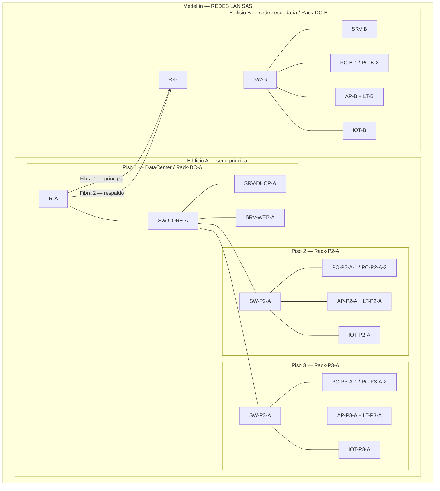

# Parte 1 — Topología física (Santiago)

Proyecto Integrador 1.ª parte · Redes LAN · ITM · REDES LAN SAS (Medellín)

## 1. Resumen

Esta parte deja armada la **ciudad, los dos edificios, los racks y todo el cableado**. No incluye IPs, VLANs, DHCP ni RIP (eso lo configuran Sebastián y el tercer compañero sobre este mismo `.pkt`).

Queda listo para Sebastián:

- Nombres fijos de cada dispositivo.
- Qué puerto de qué equipo va a qué puerto (tabla de abajo y `docs/mapa-de-puertos.csv`).
- Una propuesta preliminar de VLANs y redes (ajustable).
- Dos enlaces de fibra independientes entre `R-A` y `R-B` para la redundancia.

Archivo Packet Tracer: `packet-tracer/redes-lan-proyecto.pkt`.

## 2. Esquema de la topología



En cada edificio hay al menos un equipo de cada VLAN (5 DMZ, 6 administrativa, 10 Wi-Fi/IoT) para poder probar ping cuando esté la config.

## 3. Inventario

Modelos recomendados (si no aparecen exactamente así, usar el equivalente más cercano y anotar el cambio):

| Rol | Modelo sugerido | Nota |
|---|---|---|
| Router de borde | **Cisco 2911** | 3 GE cobre de fábrica + 4 slots HWIC |
| Switch | **2960-24TT** | 24 FastEthernet + 2 Gigabit (uplinks) |
| Servidor | Server-PT | IP fija (la pone Sebastián) |
| PC / laptop | PC-PT / Laptop-PT | DHCP |
| AP | Access-Point-PT | Uplink por cable; clientes por Wi-Fi |
| IoT | **SBC-PT** | Tiene Ethernet. Si no está, usar PC-PT con el mismo nombre |

### Edificio A — Piso 1 · DataCenter · `Rack-DC-A`

| Nombre | Tipo | VLAN de acceso |
|---|---|---|
| `R-A` | Router 2911 | — (borde + router-on-a-stick) |
| `SW-CORE-A` | Switch 2960-24TT | — (core / distribución) |
| `SRV-DHCP-A` | Server-PT (DHCP/DNS) | 5 |
| `SRV-WEB-A` | Server-PT (web / DMZ) | 5 |
| `PP-FIBRA-A` | Patch Panel (opcional, modo físico) | — |

### Edificio A — Piso 2 · `Rack-P2-A`

| Nombre | Tipo | VLAN de acceso |
|---|---|---|
| `SW-P2-A` | Switch 2960-24TT | — |
| `PC-P2-A-1` | PC-PT | 6 |
| `PC-P2-A-2` | PC-PT | 6 |
| `AP-P2-A` | Access-Point-PT | 10 |
| `LT-P2-A` | Laptop-PT (Wi-Fi a `AP-P2-A`) | 10 |
| `IOT-P2-A` | SBC-PT | 10 |

### Edificio A — Piso 3 · `Rack-P3-A`

| Nombre | Tipo | VLAN de acceso |
|---|---|---|
| `SW-P3-A` | Switch 2960-24TT | — |
| `PC-P3-A-1` | PC-PT | 6 |
| `PC-P3-A-2` | PC-PT | 6 |
| `AP-P3-A` | Access-Point-PT | 10 |
| `LT-P3-A` | Laptop-PT (Wi-Fi a `AP-P3-A`) | 10 |
| `IOT-P3-A` | SBC-PT | 10 |

### Edificio B · `Rack-DC-B`

Se añade `SRV-B` respecto a la propuesta base: sin él el Edificio B no tendría equipo de VLAN 5 para el ping.

| Nombre | Tipo | VLAN de acceso |
|---|---|---|
| `R-B` | Router 2911 | — |
| `SW-B` | Switch 2960-24TT | — |
| `SRV-B` | Server-PT (prueba DMZ) | 5 |
| `PC-B-1` | PC-PT | 6 |
| `PC-B-2` | PC-PT | 6 |
| `AP-B` | Access-Point-PT | 10 |
| `LT-B` | Laptop-PT (Wi-Fi a `AP-B`) | 10 |
| `IOT-B` | SBC-PT | 10 |
| `PP-FIBRA-B` | Patch Panel (opcional, modo físico) | — |

## 4. Enlaces entre sedes (fibra + redundancia)

Dos enlaces **independientes** `R-A` ↔ `R-B`. Si uno cae, el otro mantiene la conectividad (RIP lo hará el tercer compañero; tú solo deja los dos cables puestos).

### Qué poner en cada router (Packet Tracer)

Documentado en la ayuda de PT para el **2911** y confirmado en foros de Cisco: hay que instalar **los dos** módulos, si no el cable de fibra no engancha.

| Orden | Módulo | Dónde |
|---|---|---|
| 1 | `HWIC-1GE-SFP` | Slot HWIC **0** (enlace principal) |
| 2 | `GLC-LH-SMD` | Dentro de esa tarjeta SFP |
| 3 | `HWIC-1GE-SFP` | Slot HWIC **1** (enlace de respaldo) |
| 4 | `GLC-LH-SMD` | Dentro de esa segunda tarjeta |

Pasos en PT: apagar el router → arrastrar `HWIC-1GE-SFP` al slot → arrastrar `GLC-LH-SMD` al hueco SFP de la tarjeta → encender → cable **Fiber** (naranja) entre los dos SFP.

**Nombre de la interfaz: POR VERIFICAR en Packet Tracer.** Después de encender, en el CLI:

```text
show ip interface brief
```

Anota el nombre real (suele ser algo como `GigabitEthernet0/0/0` y `GigabitEthernet0/1/0`, o `GigabitEthernet1/0` y `GigabitEthernet2/0`). Escribe ese nombre en el `.pkt` (etiqueta) y, si cambia, avísale a Sebastián. En las tablas de abajo se usa el placeholder `Gi-SFP-0` / `Gi-SFP-1`.

En modo lógico se puede cablear router a router. En modo físico se puede pasar por `PP-FIBRA-A` y `PP-FIBRA-B`; el mapa lógico de abajo asume enlace directo.

## 5. Mapa de puertos

Convenciones del profesor:

- Usuarios: de **izquierda a derecha**, desde el puerto 1.
- Troncales: **últimos puertos**, de derecha a izquierda (`Gig0/2`, luego `Gig0/1`, luego `Fa0/24`).
- Router → switch: **troncal** (router-on-a-stick). Usuarios: **acceso**.
- Cobre: cable **Straight-Through** (directo). Entre sedes: **Fiber**.

Puertos de PC/servidor en PT: `FastEthernet0`. AP: `Port 0`. IoT SBC-PT: **POR VERIFICAR** (suele ser `FastEthernet0`).

### 5.1 SW-CORE-A (Rack-DC-A)

| Origen | Puerto | Destino | Puerto | Cable | Rol |
|---|---|---|---|---|---|
| SW-CORE-A | Fa0/1 | SRV-DHCP-A | FastEthernet0 | cobre directo | acceso VLAN 5 |
| SW-CORE-A | Fa0/2 | SRV-WEB-A | FastEthernet0 | cobre directo | acceso VLAN 5 |
| SW-CORE-A | Fa0/24 | SW-P3-A | Gig0/2 | cobre directo | troncal |
| SW-CORE-A | Gig0/1 | SW-P2-A | Gig0/2 | cobre directo | troncal |
| SW-CORE-A | Gig0/2 | R-A | GigabitEthernet0/0 | cobre directo | troncal (hacia router) |

### 5.2 R-A

| Origen | Puerto | Destino | Puerto | Cable | Rol |
|---|---|---|---|---|---|
| R-A | GigabitEthernet0/0 | SW-CORE-A | Gig0/2 | cobre directo | troncal LAN |
| R-A | Gi-SFP-0 | R-B | Gi-SFP-0 | fibra | WAN principal |
| R-A | Gi-SFP-1 | R-B | Gi-SFP-1 | fibra | WAN respaldo |

`GigabitEthernet0/1` y `GigabitEthernet0/2` de fábrica se dejan libres.

### 5.3 SW-P2-A

| Origen | Puerto | Destino | Puerto | Cable | Rol |
|---|---|---|---|---|---|
| SW-P2-A | Fa0/1 | PC-P2-A-1 | FastEthernet0 | cobre directo | acceso VLAN 6 |
| SW-P2-A | Fa0/2 | PC-P2-A-2 | FastEthernet0 | cobre directo | acceso VLAN 6 |
| SW-P2-A | Fa0/3 | AP-P2-A | Port 0 | cobre directo | acceso VLAN 10 |
| SW-P2-A | Fa0/4 | IOT-P2-A | FastEthernet0 | cobre directo | acceso VLAN 10 |
| SW-P2-A | Gig0/2 | SW-CORE-A | Gig0/1 | cobre directo | troncal |

### 5.4 SW-P3-A

| Origen | Puerto | Destino | Puerto | Cable | Rol |
|---|---|---|---|---|---|
| SW-P3-A | Fa0/1 | PC-P3-A-1 | FastEthernet0 | cobre directo | acceso VLAN 6 |
| SW-P3-A | Fa0/2 | PC-P3-A-2 | FastEthernet0 | cobre directo | acceso VLAN 6 |
| SW-P3-A | Fa0/3 | AP-P3-A | Port 0 | cobre directo | acceso VLAN 10 |
| SW-P3-A | Fa0/4 | IOT-P3-A | FastEthernet0 | cobre directo | acceso VLAN 10 |
| SW-P3-A | Gig0/2 | SW-CORE-A | Fa0/24 | cobre directo | troncal |

### 5.5 SW-B y R-B

| Origen | Puerto | Destino | Puerto | Cable | Rol |
|---|---|---|---|---|---|
| SW-B | Fa0/1 | PC-B-1 | FastEthernet0 | cobre directo | acceso VLAN 6 |
| SW-B | Fa0/2 | PC-B-2 | FastEthernet0 | cobre directo | acceso VLAN 6 |
| SW-B | Fa0/3 | SRV-B | FastEthernet0 | cobre directo | acceso VLAN 5 |
| SW-B | Fa0/4 | AP-B | Port 0 | cobre directo | acceso VLAN 10 |
| SW-B | Fa0/5 | IOT-B | FastEthernet0 | cobre directo | acceso VLAN 10 |
| SW-B | Gig0/2 | R-B | GigabitEthernet0/0 | cobre directo | troncal (hacia router) |
| R-B | GigabitEthernet0/0 | SW-B | Gig0/2 | cobre directo | troncal LAN |
| R-B | Gi-SFP-0 | R-A | Gi-SFP-0 | fibra | WAN principal |
| R-B | Gi-SFP-1 | R-A | Gi-SFP-1 | fibra | WAN respaldo |

### 5.6 Enlaces inalámbricos (sin cable)

| Cliente | Se asocia a | VLAN |
|---|---|---|
| LT-P2-A | AP-P2-A | 10 |
| LT-P3-A | AP-P3-A | 10 |
| LT-B | AP-B | 10 |

SSID lo define Sebastián. Coloca cada laptop cerca de su AP para que tome señal.

## 6. Propuesta preliminar de VLANs y direccionamiento

**No es definitiva.** La configuración la decide y aplica Sebastián.

Convención de clase: VLAN *N* → subinterfaz `GigabitEthernet0/0.N` → red `192.168.N.0`. Máscara **/25** (`255.255.255.128`). Gateway = primera IP válida (`.1`). Servidores con IP fija. PCs, laptops e IoT por DHCP (`ip helper-address` en las subinterfaces, hacia `SRV-DHCP-A`).

### Edificio A (la convención se cumple tal cual)

| VLAN | Nombre | Red | Máscara | Subinterfaz R-A | Gateway |
|---|---|---|---|---|---|
| 5 | DMZ / servidores | 192.168.5.0/25 | 255.255.255.128 | Gi0/0.5 | 192.168.5.1 |
| 6 | Administrativa | 192.168.6.0/25 | 255.255.255.128 | Gi0/0.6 | 192.168.6.1 |
| 10 | Wi-Fi / IoT | 192.168.10.0/25 | 255.255.255.128 | Gi0/0.10 | 192.168.10.1 |

IPs fijas sugeridas: `SRV-DHCP-A` = 192.168.5.2 · `SRV-WEB-A` = 192.168.5.3

### Edificio B (mismas VLAN, redes distintas para que RIP no choque)

Si B usara también `192.168.5.0/25`, las dos sedes anunciarían la misma red. Propuesta: se mantiene VLAN 5/6/10 y el número de subinterfaz; el tercer octeto lleva un `1` delante.

| VLAN | Nombre | Red | Máscara | Subinterfaz R-B | Gateway |
|---|---|---|---|---|---|
| 5 | DMZ / servidores | 192.168.105.0/25 | 255.255.255.128 | Gi0/0.5 | 192.168.105.1 |
| 6 | Administrativa | 192.168.106.0/25 | 255.255.255.128 | Gi0/0.6 | 192.168.106.1 |
| 10 | Wi-Fi / IoT | 192.168.110.0/25 | 255.255.255.128 | Gi0/0.10 | 192.168.110.1 |

IP fija sugerida: `SRV-B` = 192.168.105.2

### WAN entre routers (para RIP, parte 3)

| Enlace | Red | R-A | R-B |
|---|---|---|---|
| Fibra 1 (principal) | 10.0.0.0/30 | 10.0.0.1 | 10.0.0.2 |
| Fibra 2 (respaldo) | 10.0.0.4/30 | 10.0.0.5 | 10.0.0.6 |

## 7. Checklist para construir en Packet Tracer

Se puede trabajar en modo lógico o físico (el profesor acepta ambos). El físico se ve mejor en la sustentación. Recomendación: **crear la estructura física primero**, colocar dispositivos y cablear mirando también el modo lógico.

### 7.1 Modo físico (recomendado)

1. Abrir Packet Tracer → vista **Physical**.
2. Crear o renombrar la ciudad a **Medellín**.
3. Añadir **Edificio A** (sede principal) y **Edificio B** (sede secundaria).
4. En Edificio A, dejar **3 pisos**. En Edificio B basta **1 piso**.
5. En cada piso, crear un wiring closet de **5 × 5 m**.
6. Poner un rack en cada closet:
   - A piso 1: `Rack-DC-A`
   - A piso 2: `Rack-P2-A`
   - A piso 3: `Rack-P3-A`
   - B: `Rack-DC-B`
7. Colocar los dispositivos del inventario en su rack (sección 3). Renombrarlos **antes** de cablear.
8. En `R-A` y `R-B`: instalar `HWIC-1GE-SFP` + `GLC-LH-SMD` × 2 (sección 4). Verificar el nombre de interfaz.
9. Cablear según la sección 5. Cobre intra-edificio; fibra solo `R-A` ↔ `R-B` (dos veces).
10. Asociar cada laptop a su AP (cerca, para que haya cobertura).
11. Volver al modo **Logical** y comprobar que todos los enlaces estén en verde.
12. Guardar como `packet-tracer/redes-lan-proyecto.pkt`.

### 7.2 Modo lógico (si empiezas por aquí)

1. Arrastrar todos los dispositivos del inventario y renombrarlos.
2. Instalar módulos de fibra en `R-A` y `R-B`.
3. Cablear con la tabla de la sección 5.
4. Asociar laptops a los AP.
5. (Opcional) Pasar a Physical y acomodar ciudad → edificios → closets → racks.
6. Guardar como `packet-tracer/redes-lan-proyecto.pkt`.

### 7.3 Qué no configurar (aún)

- No crear VLANs, no poner IPs, no armar pools DHCP, no activar RIP.
- Sí puedes dejar notas/etiquetas en el lienzo (nombres de racks y “Fibra 1 / Fibra 2”).

## 8. Convención de nombres

| Qué | Formato | Ejemplo |
|---|---|---|
| Router | `R-<edificio>` | `R-A` |
| Switch | `SW-<rol>-<edificio>` | `SW-CORE-A`, `SW-P2-A`, `SW-B` |
| Servidor | `SRV-<rol>-<edificio>` | `SRV-DHCP-A`, `SRV-B` |
| PC | `PC-<piso>-<edificio>-<n>` | `PC-P2-A-1` |
| AP / laptop / IoT | `AP-` / `LT-` / `IOT-` + ubicación | `AP-P3-A`, `LT-B` |
| Rack | `Rack-DC-A`, `Rack-P2-A`, `Rack-P3-A`, `Rack-DC-B` | |
| Archivo | `packet-tracer/redes-lan-proyecto.pkt` | |

No uses espacios ni tildes en los nombres de dispositivos.
